# Setting up immichset

> **New here?** Start with [START-HERE.md](START-HERE.md). It picks the right path for you: installing everything
> including Immich in one command ([install/NEW.md](install/NEW.md)), or adding immichset to an Immich you already have
> ([install/HAVE-IMMICH.md](install/HAVE-IMMICH.md)). This page is the detailed reference for the setup screens.

If the installer included Immich, the setup page's Immich step looks like this and creates your Immich account for you:


This takes about ten minutes. You install one container, open a page in your browser, and paste in a few
keys. The page tests each one and tells you in plain words what to fix.

> The pictures of immichset in this guide are real screenshots from a demo install with sample photos and a made-up
> studio ("Maple Street Photo"), so your own values will differ. Docker, your NAS and Immich look different on every
> device and version, so for those this guide says where to click and links the official instructions instead of
> showing a picture that might be wrong for you.

## Starting from nothing

If you have never done this before, there are three things to put in place first. Each takes a few minutes, and
the first two have excellent official guides:

1. **A computer that stays on and can run Docker.** A NAS (Synology, Ugreen, QNAP, Unraid, TrueNAS), a mini PC, or a
   Raspberry Pi 4/5 all work. Docker is an app that runs programs in tidy boxes.
   - *NAS:* open its app store (Synology: **Package Center**, search **Container Manager**; Ugreen, QNAP and Unraid
     have a **Docker** app) and install it.
   - *Any other computer:* follow [docs.docker.com/get-docker](https://docs.docker.com/get-docker/).
2. **Immich**, which keeps your photos and makes the thumbnails. Install it with its own guide:
   [immich.app/docs/install/requirements](https://immich.app/docs/install/requirements), then create your account,
   and upload (or import) a few photos into an **album**. immichset shows albums, so a gallery needs one.
   Note the address you open Immich at, for example `http://192.168.1.20:2283`. You'll need it in a minute.
3. **A way for clients to reach the gallery over the internet** (only when you're ready to share). This is a
   domain name plus either a Cloudflare Tunnel or your router and a reverse proxy. You can do everything else
   first and add this last; section 5 explains it.

You do **not** need a domain, Resend or Cloudflare to try it at home. Those only matter once clients are involved.

**What you need first**

- **Immich**, already running, with at least one album. immichset reads your photos from it; it does not
  replace it.
- **A way for clients to reach this server over https.** A domain name pointed at your home or server, a
  reverse proxy (Caddy, nginx, or the one built into your NAS), or a free Cloudflare Tunnel. You can set
  everything up first and add this last.
- **Optionally, a Resend account** (free to start) if you want gallery emails, expiry reminders and the
  emailed sign-in code.

---

## 1. Install

Save [`docker-compose.quickstart.yml`](../docker-compose.quickstart.yml) as `docker-compose.yml`, set your time
zone in it, then:

```bash
docker compose up -d
```

(Without Compose: `docker run -d --name immichset --init --restart unless-stopped -p 3000:3000 -e BACKUP_DIR=/backups -v immichset-data:/data -v immichset-backups:/backups ghcr.io/natephotos/immichset:latest`)

The first start prints a **setup code**. Find it with:

```bash
docker logs immichset
```

Open `http://<your server>:3000/setup` and enter the code. It stops anyone else on your network from
setting up your server before you do. The page disappears for good when you finish.

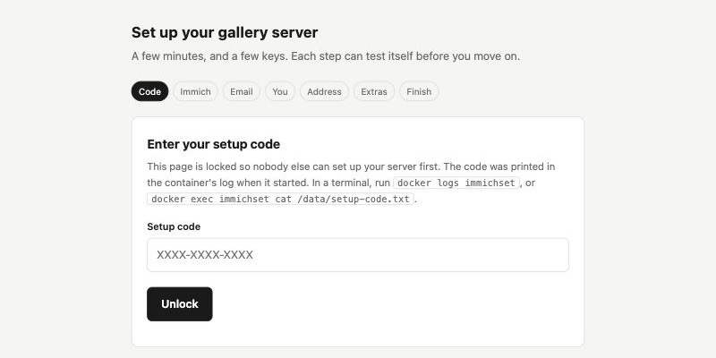

## 2. Immich: your read key

In Immich, click your picture › **Account Settings** › **API Keys** › **New API Key**. Name it
"gallery read" and tick:

`album.read` · `timeline.read` · `asset.read` · `asset.view` · `asset.download` · and, if listed,
`album.download` · `timeline.download`

Do **not** choose "All". The key is shown once, so copy it straight into the setup page. The page's
**Test connection** button tries everything the app does and, if a permission is missing, names the exact one
to tick.

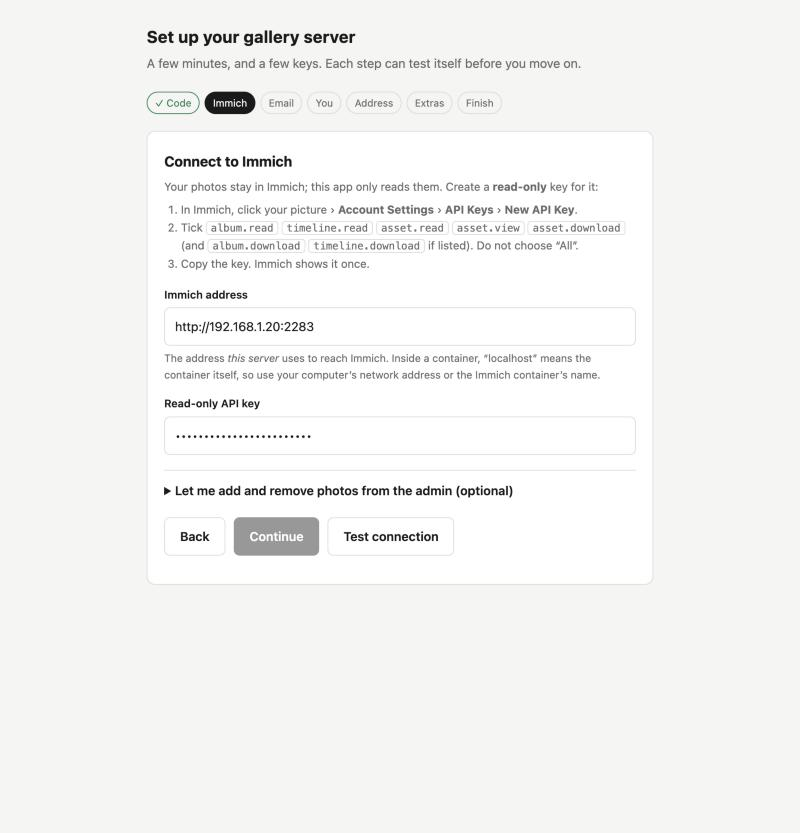

Press **Test connection**. It tries everything the app does and shows a tick for each:

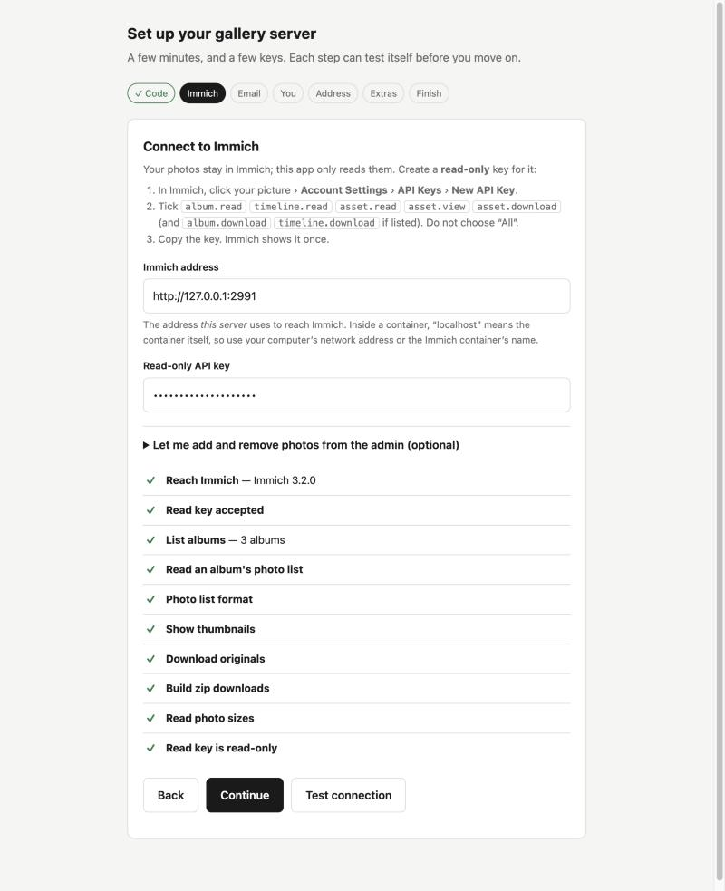

If something's wrong it says what, in plain words. Two you're most likely to meet:

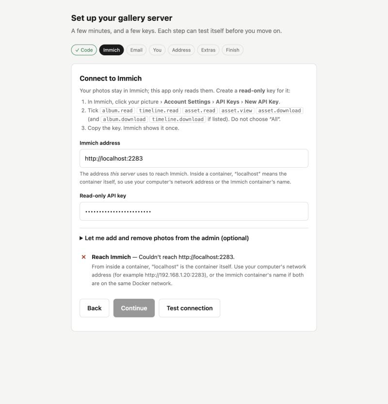

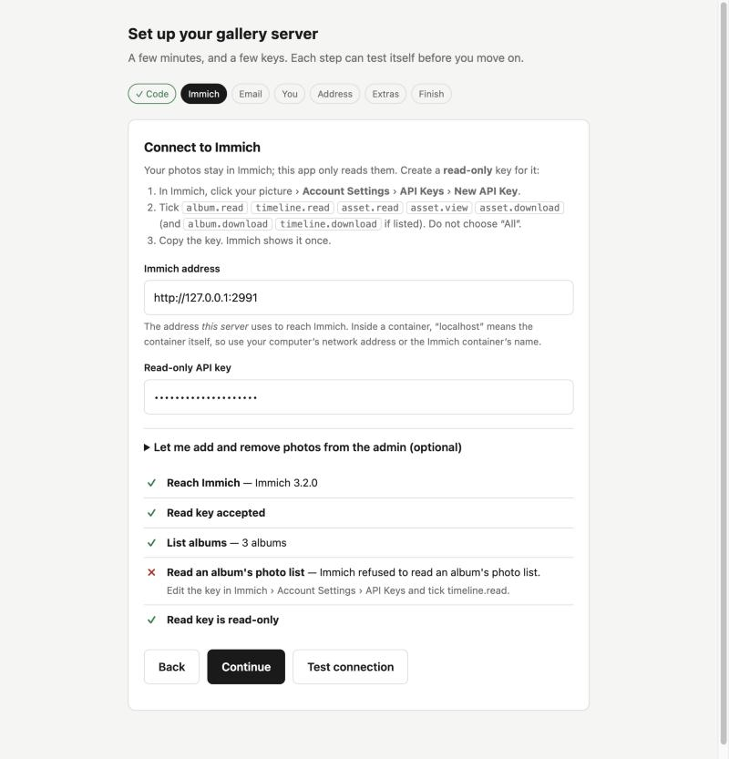

**Immich address.** Use the address *this server* can reach, such as `http://192.168.1.20:2283`. Inside a
container, `localhost` is the container itself, so it won't work. If Immich runs in another compose project on
the same computer, use the computer's network address, or put both on one Docker network and use the Immich
container's name.

### Optional: a write key

Only if you want to add or remove photos from the admin panel. Make a **second** key with `asset.upload`,
`album.create`, `albumAsset.create` (to add) and `asset.delete`, `albumAsset.delete` (to remove). Grant only
the half you want. It is kept separate so the read key, which serves your clients, can never change anything
in your library.

## 3. Email (Resend)

1. Sign up at [resend.com](https://resend.com). Under **Domains**, add your domain (or a subdomain such as
   `mail.yourdomain.com`). Add the DNS records it lists (SPF, DKIM, and MX) wherever your domain's DNS is
   kept, and wait for it to say **Verified**.
2. Under **API Keys**, create a key with **Sending access**, limited to that domain. Copy it.
3. In the setup page, paste the key, set **Send from** to something like `Your Studio <hello@yourdomain.com>`,
   enter an address to send a test to, and press **Send test email**.

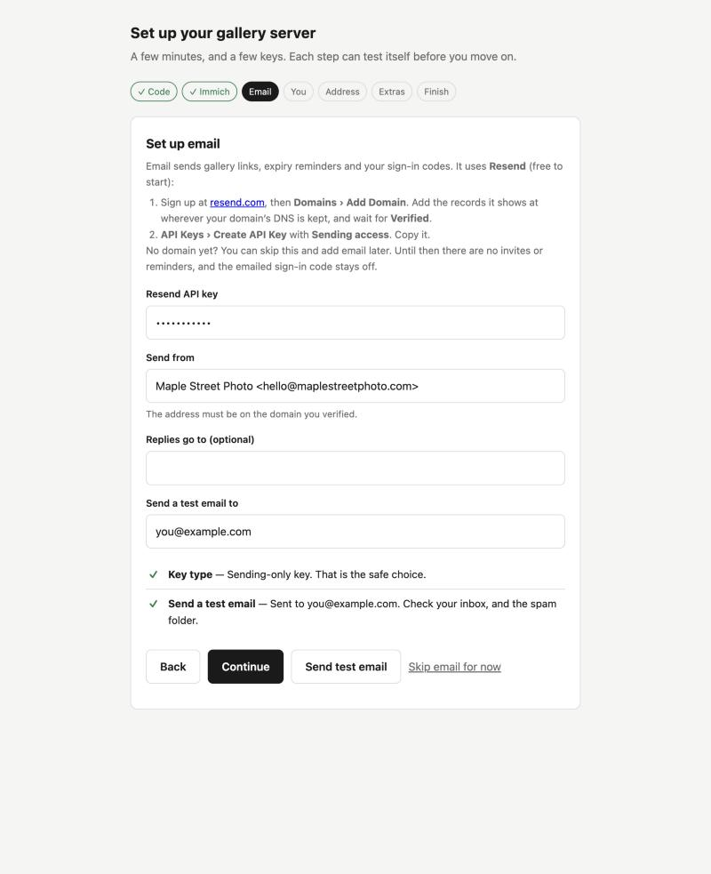

No domain yet? **Skip** this step. You can add it later under **Connections**. Until then there are no
invites, reminders or mailings, and the emailed sign-in code stays off (the page does this for you so you can
never lock yourself out).

Resend's free plan allows 100 emails a day; if that's you, set **Most emails a day** to 100 under
Connections › Mailings.

## 4. You and your business

Choose the email and password you will sign in with (12 characters or more). Your business name appears on
galleries and emails. A **postal address or PO box** is required by law in the footer of every marketing
email, so mailings stay locked until you add one. You can add it later.

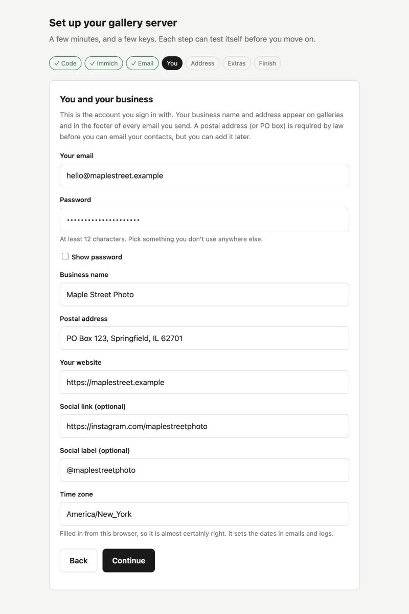

**Emailed sign-in code.** Once email has been tested, every sign-in also asks for a code emailed to you.

## 5. Your public address

This is the https address your clients will use, for example `https://galleries.yourstudio.com`. Links in
emails are built from it. To make it work, put a reverse proxy or a Cloudflare Tunnel in front of port 3000:

- **Cloudflare Tunnel:** create a tunnel, add a public hostname, and point it at `http://<this server>:3000`.
- **Caddy:** `galleries.yourstudio.com { reverse_proxy localhost:3000 }`
- **Synology / Ugreen / QNAP:** use the built-in reverse proxy (Control Panel › Login Portal › Advanced ›
  Reverse Proxy) to send your hostname to port 3000, with a certificate.

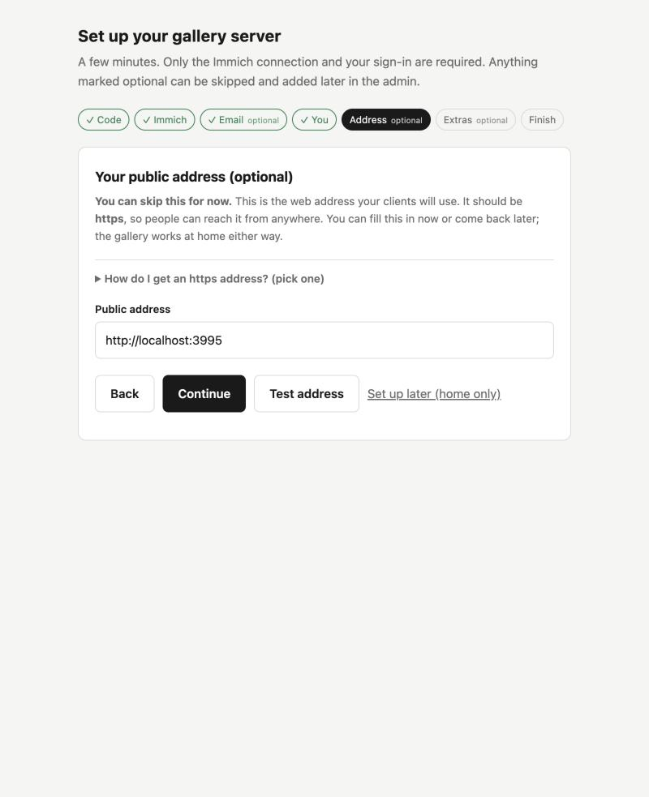

The page can't always confirm the address from the inside (many home routers can't reach their own public
address). If it says so, check it from your phone on mobile data.

## 6. Optional extras

Each of these can be skipped and added later.

- **Dynamic DNS.** If your internet provider changes your home address, the app can keep one DNS record up to
  date. Needs a Cloudflare token with *Zone › DNS › Edit* for that one domain (or a Hostinger token). The record
  must already exist; the app never creates one.
- **Website publishing.** Publishes a portfolio site to Cloudflare Pages. Needs your account ID, a project name,
  and a token with *Account › Cloudflare Pages › Edit*.
- **Bounce handling.** In Resend › Webhooks, add `https://<your address>/api/mail/webhook` with the events
  `email.bounced` and `email.complained`, and paste the signing secret. Addresses that bounce or complain are
  then never mailed again.

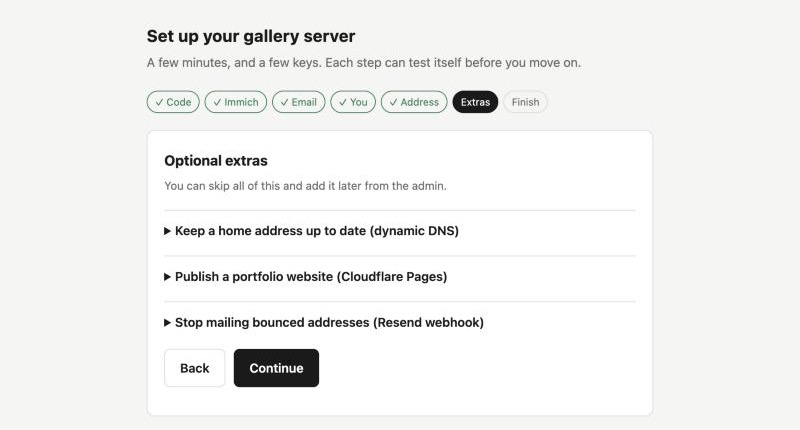

Then **Review**, and **Finish setup**:

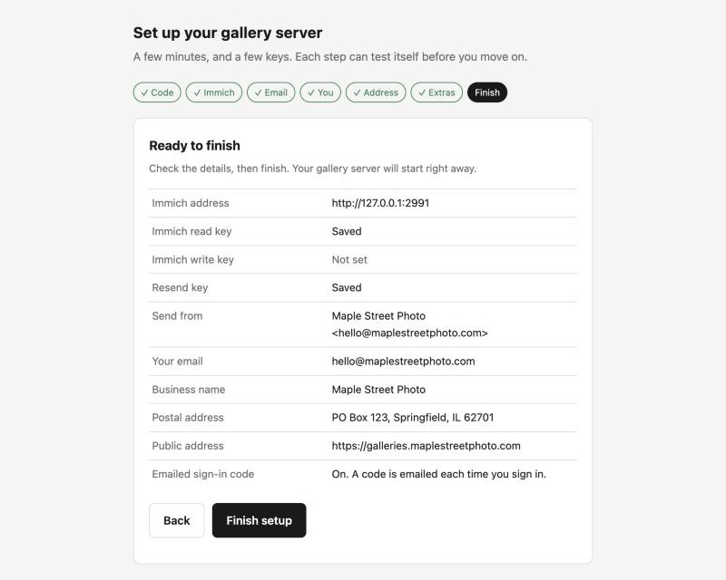

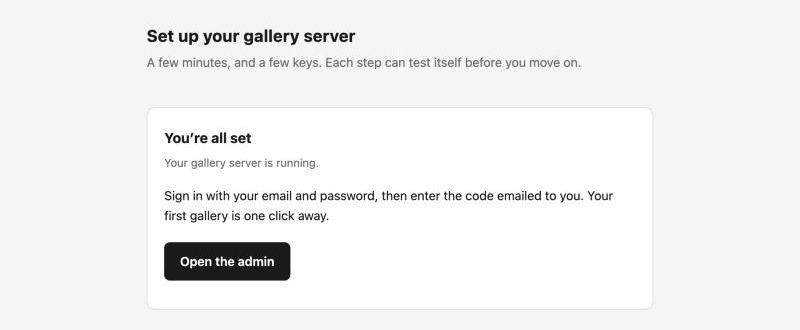

## 7. First sign-in

Open `/admin`, sign in with your email and password, and enter the code that was emailed to you.

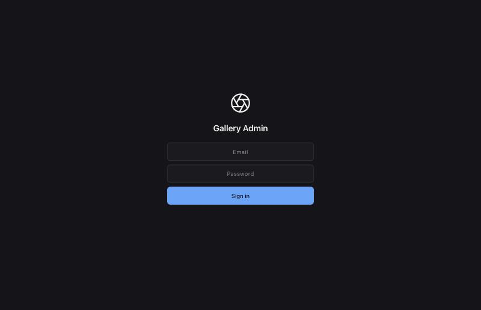

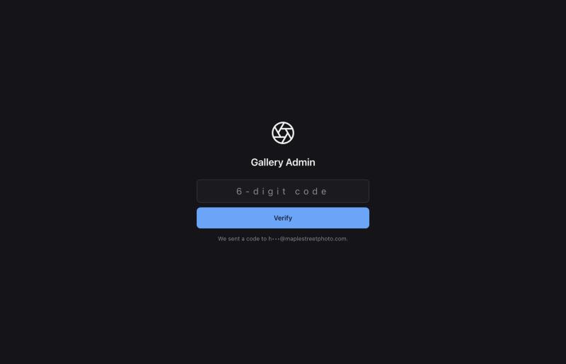

You land on **Home**: your galleries, this week's numbers, and a health strip for backups and email.

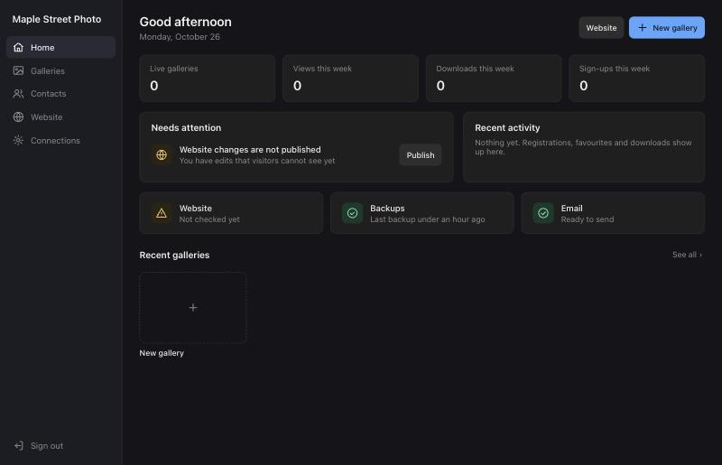

## 8. Your first gallery

Press **New gallery**. Pick the Immich album, give it a title (the web address fills itself in), and choose
whether clients need to leave an email, whether they can download, and whether to publish it now. Add a password
if you want one. Email and password are independent: use either, both, or neither.

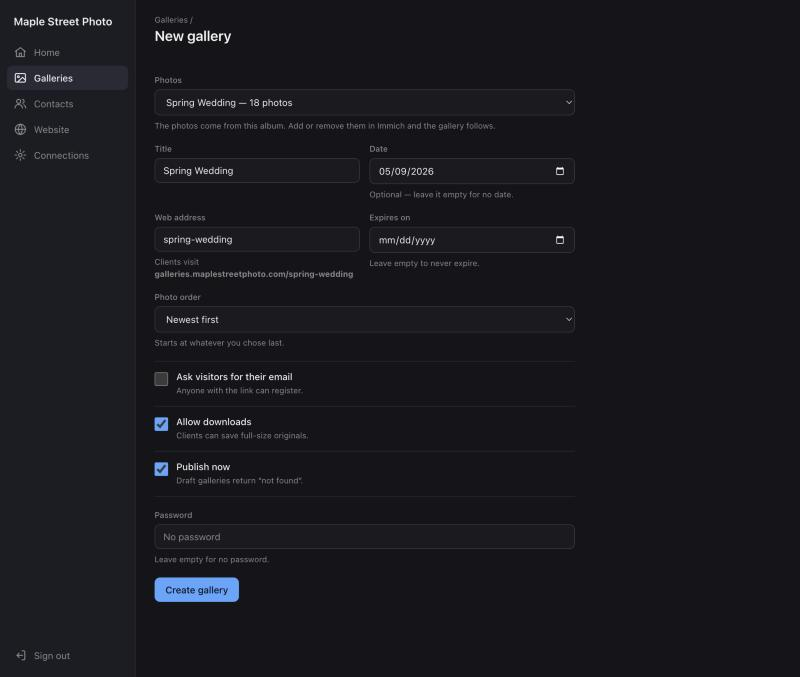

The gallery opens on its photos. Add or remove photos in Immich and the gallery follows. **Preview** shows what
clients see, and **Copy link** gives you the address to send them.

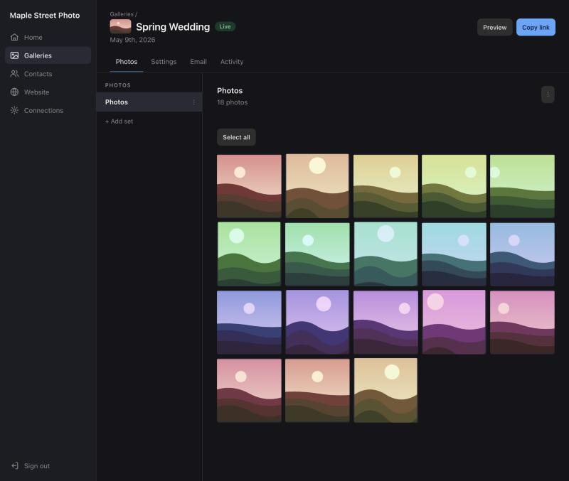

Everything about a gallery lives under **Settings**:

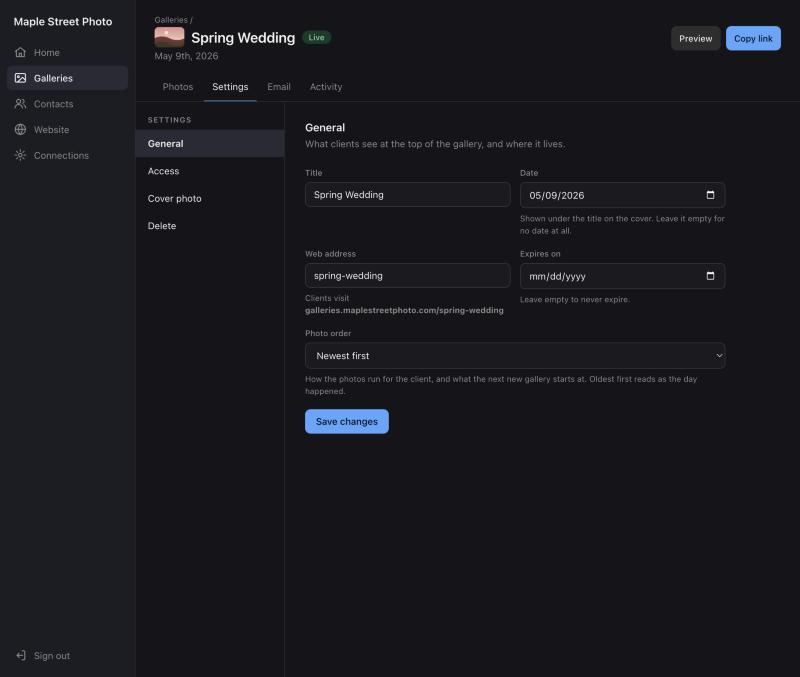

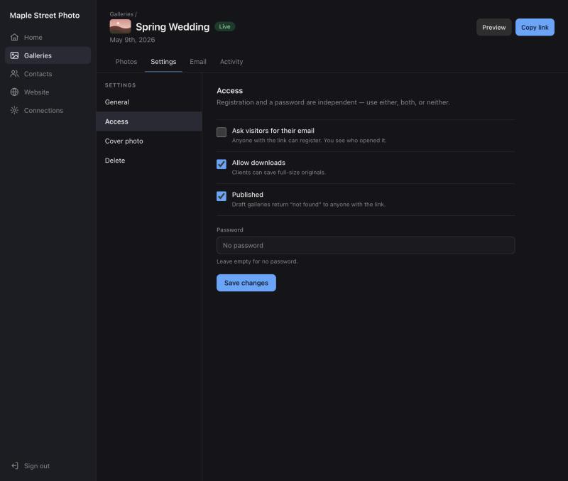

This is what a client sees: a cover, then the photos in a justified grid with favourites, a slideshow and a
download-all button.

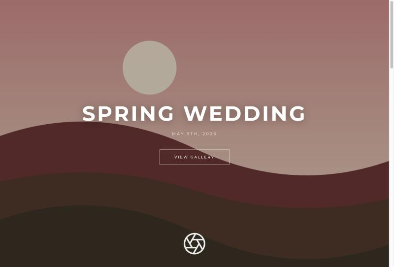

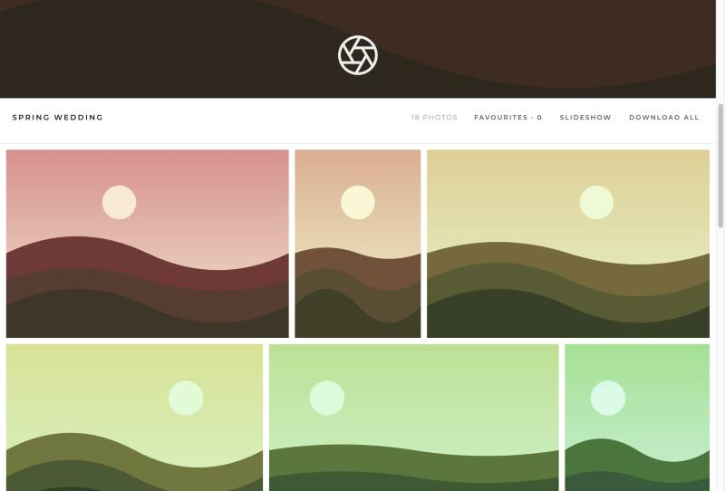

---

## What "public" means

Only gallery pages are reachable by clients, each behind the gate you choose (an email, a password, both, or
neither). Immich and its keys are never exposed to a browser; every photo is fetched through this app, so a
forwarded link can't reach anything it shouldn't. The admin needs your password and the emailed code.

Gallery pages load their typeface (Montserrat by default) from Google Fonts, so a client's browser contacts Google
when it opens a gallery. If that matters to you, choose one of the **no download** fonts under Design; those use the
fonts already on the visitor's device and nothing is fetched from Google. See [Design](DESIGN.md).

## Where your settings are kept, and backups

- Keys you enter in the setup page are saved in **`/data/immichset.json`**, readable only by the app. It is
  **not encrypted**: the key to decrypt it would have to sit beside it, which would protect nothing. Anyone who
  can read your data folder can read your keys, as with any compose file.
- A setting saved in the admin panel wins over the same setting in the compose file; clear it in the panel to go back to the compose file's value.
- The nightly backups in `/backups` copy your **database and covers** (and pictures used in mailings). They do
  **not** include `immichset.json`, because a backup folder is often a shared drive. After setup, open
  **Connections › Download settings file** (needs your browser sign-in) and keep that file somewhere private.
- **Restoring:** put the database backup and `immichset.json` back in `/data`. If you lose the settings file,
  setup starts again and your account is kept, but everyone is signed out and the unsubscribe links in emails
  already sent stop working (they show a page asking people to reply instead). Immich has its own backup; this
  app only reads from it.

## Updating

```bash
docker compose pull && docker compose up -d
```

Your data lives in volumes, so nothing is lost. On the first start of a new version the app keeps a copy of
the database as it was (`/data/pre-upgrade-<version>.db`, the last three are kept), because an upgrade can't be
undone. To go back, restore that copy and run the older image.

## Changing a key later

Open **Connections** in the admin. Every key has a Test button, and changes to keys, addresses and branding
apply at once.

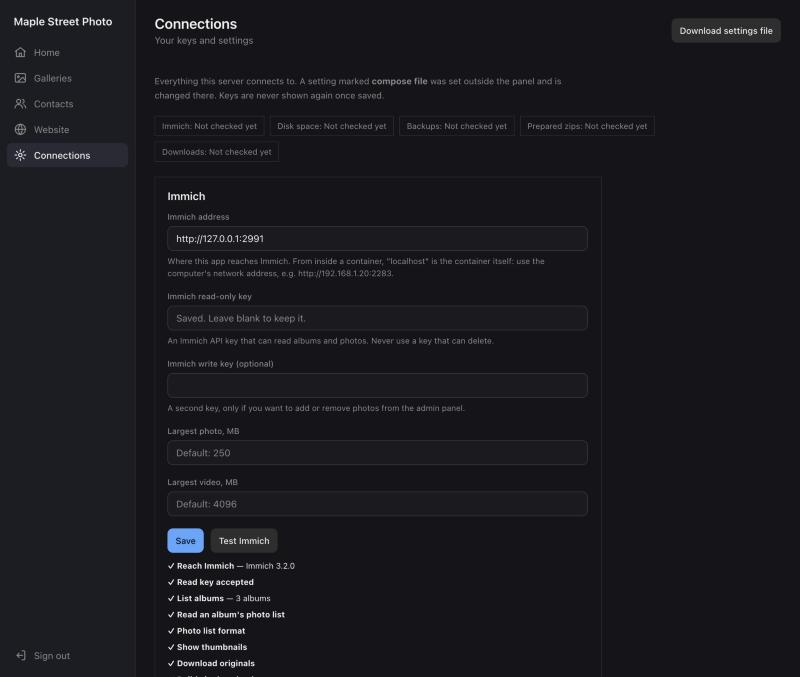

A setting that started in the compose file is marked as such; saving a different value in the panel overrides it. Changing settings
needs you to be signed in in the browser; the API token can't do it.

---

## Troubleshooting

**1. "Couldn't reach Immich."** The address must be one this container can reach. `localhost` and
`127.0.0.1` are the container itself. Use the computer's network address (and the right port, usually 2283).

**2. "Immich did not recognise that key."** Copy it again; Immich only shows it once. Make sure there is no
trailing space.

**3. "Immich refused to… tick `timeline.read`."** Edit the key in Immich › Account Settings › API Keys and tick
the permission named. The page names it exactly.

**4. "The domain isn't verified in Resend."** Add the DNS records Resend lists (SPF, DKIM, MX) and wait for
**Verified** at resend.com/domains. Send from an address on that domain.

**5. The sign-in code never arrives.** Check spam. To get back in right now, set `ADMIN_2FA: "off"` in your
compose file and restart; then fix email under Connections and turn it back on.

**6. Links in emails are http, or point to the wrong address.** Change **Public address** under Connections.

**7. "Permission denied" on `/data`, or the page says the data folder isn't writable.** The container runs as
user 1000. If you mounted a folder from your computer, run `chown -R 1000:1000 <that folder>`, or give the
container `user: "<your uid>:<your gid>"`. A named volume (as in the quickstart) just works.

**8. I lost the setup code, or it says too many wrong tries.** `docker exec immichset cat /data/setup-code.txt`
shows it. Restarting the container clears the lockout.

---

## What can't be checked without your own accounts

The tests in this repository run the whole install against stand-ins for Immich and Resend. They can't check
the exact wording of Resend's errors, the permission names on your Immich version (the app reads the missing
permission straight out of Immich's reply, so that corrects itself), or how your domain's DNS behaves. If a
Test button shows something confusing, please open an issue with what it said.
