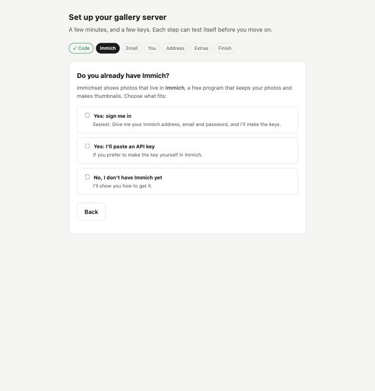
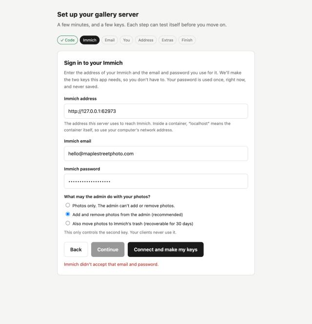

# Add immichset to an Immich you already run

You already have Immich with photos in it. immichset only needs to be able to **read** albums from it.

## Option A: the installer (recommended)

If Immich runs in Docker on the same computer, the installer finds it and connects to it. In a terminal on that computer:

```bash
curl -fsSLO https://raw.githubusercontent.com/NatePhotos/immichset/main/install/install.sh
```

```bash
sh install.sh
```

It says "I found Immich already running here", installs **only immichset**, and joins it to Immich's network so the setup
page can find it. Your Immich is not touched. If Immich is on another computer, run `sh install.sh --no-immich` and enter
its address in the setup page.

## Option B: a compose file (Synology, Ugreen and other NAS apps with a "Project" screen)

If you would rather paste a file into your NAS's Docker app, do this. (Button names differ between NAS brands and
versions; match them by meaning.)

1. Open [`docker-compose.quickstart.yml`](../../docker-compose.quickstart.yml) and copy the whole file. You don't need to
   change anything in it; the setup page fills in your time zone for you.
2. In your NAS's Docker app, go to **Project** (Synology: **Container Manager › Project › Create**; Ugreen: **Docker › Project**)
   and create a project named `immichset`. If it asks for a folder, use one on your data volume, such as
   `/volume1/docker/immichset`. Choose to paste or create a `docker-compose.yml` and paste the file. Don't pick a template.
3. Start (deploy) it. The first time it downloads the program, which takes a minute.
4. Open the project's or container's **Logs**. You'll see a box with `FIRST-TIME SETUP` and a line `Setup code: XXXX-XXXX-XXXX`.
   That code is made for your install; use the one on your screen.
5. Work out your **NAS address** (the program can't know it from inside its container). It's a number like `192.168.1.20`.
   The easiest way to find it: sign in to your NAS's own web page from your computer and look at your browser's address
   bar. Whatever is there before any `:` and port number is your NAS address. Otherwise look in your router's list of
   connected devices, or in the NAS's network settings.
6. In a browser on a computer on the same network, open `http://<your NAS address>:3000/setup` (for example
   `http://192.168.1.20:3000/setup`) and enter the code.

This route installs only immichset. On the Immich step choose "I already have Immich" and enter its address
(`http://<NAS address>:2283`) and an API key.

## Then, the setup page

Open `http://<your computer>:3000/setup` and enter the code. On the Immich step choose what fits:



- **Yes: sign me in.** Enter your Immich address, your Immich email and password, and it makes the two keys the app needs.
  Your password is used once and never saved.
- **Yes: I'll paste an API key.** If you prefer to make the key yourself in Immich (Account Settings › API Keys).



**The Immich address.** Use the address *this server* can reach, like `http://192.168.1.20:2283`. Inside a container,
`localhost` means the container itself, so it won't work. If the installer connected the networks, the address
is filled in for you.

Everything after that is the same as in [the setup guide](../SETUP.md).
