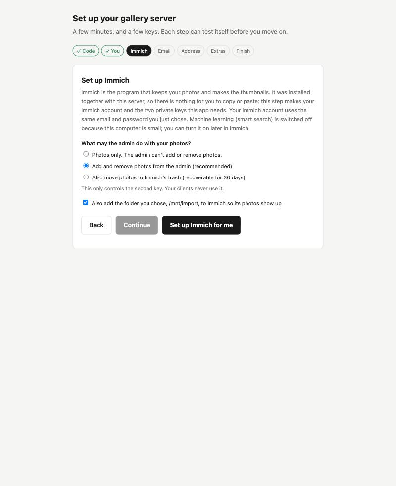
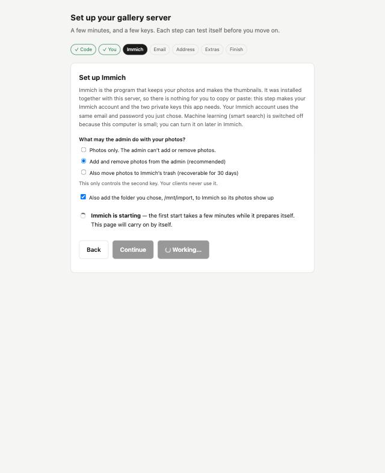
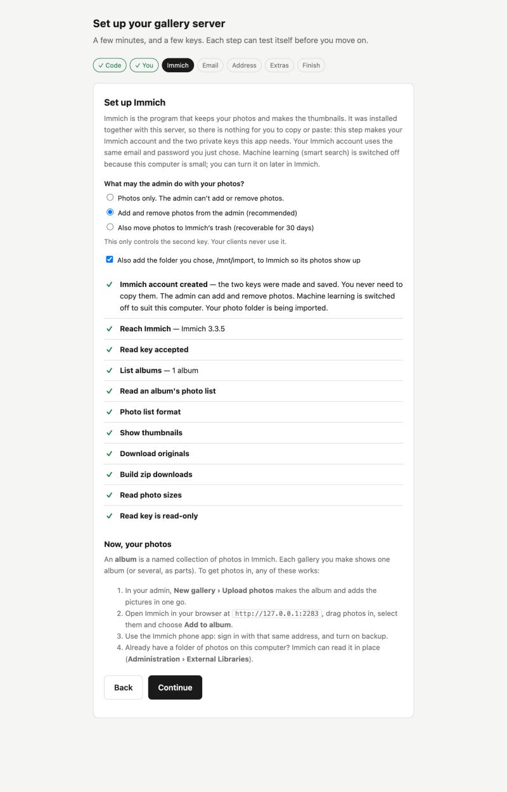

# Install everything from your NAS's Docker app (no terminal)

This is the path for a NAS with nothing installed but its Docker app (Synology Container Manager, Ugreen Docker, QNAP
Container Station and similar). You paste one file. It installs **Immich** (where your photos live) and **immichset**
(your client galleries) together. It takes about 15 minutes plus the download.

<!-- VIDEO-GUIDE:start (delete everything from this line to VIDEO-GUIDE:end to remove the video) -->
> **Prefer to watch?** This path is shown step by step, without a terminal, in a video. [Watch the install guide on YouTube](https://youtu.be/kf6_3rGQqVs). It covers installing only, not the web setup page afterwards.
<!-- VIDEO-GUIDE:end -->

**You need:** a NAS with Docker installed, at least 6 GB of memory free, and a computer on the same network. If your NAS
is older or small, read the hardware notes in [Start here](../START-HERE.md#what-your-computer-needs) first.

Button names differ between NAS brands and versions. Match them by meaning.

## 1. Copy the file

Open [`docker-compose.with-immich.yml`](../../docker-compose.with-immich.yml) on GitHub and press the **copy** button.
You don't need to change anything in it.

## 2. Create a project

In your NAS's Docker app, find **Project** (Synology: **Container Manager › Project › Create**; Ugreen: **Docker › Project**).

1. Name it `immichset`.
2. Let it choose the folder, or pick one on your main storage volume. Your photos will be in a `library` folder inside it.
3. Choose to create or paste a **docker-compose.yml** and paste the file you copied. Don't pick a template.
4. If it offers a web portal or "set up a website", skip it.
5. **Deploy** (or Start). The first time it downloads several gigabytes, so it can take a while. Wait until the project shows
   as running.

## 3. Open the setup page

1. Open the **Logs** of the container named `immichset` (in the Docker app's container list; not the whole project's log,
   which is full of Immich's messages). Find the box that says `FIRST-TIME SETUP`. It has a `Setup code`; use the one on your
   screen. The box is printed again every minute until you enter the code, so the newest one is at the bottom.
2. In a browser on a computer on the same network, open `http://NAS-ADDRESS:3000/setup`, swapping `NAS-ADDRESS` for the address
   you use to open your NAS's own web page (a number like `192.168.1.20`). Enter the code.

Don't have the address? Sign in to your NAS in a browser and look at the address bar.

## 4. Follow the setup page

Because Immich came with this file, the page offers to create your Immich account for you:

Choose an email and a password. The page creates your Immich account and the keys immichset needs. Immich may say it is
starting; give it a few minutes the first time.

Then fill in the rest as in [SETUP.md](../SETUP.md). Email and an https address are optional and can wait.

## 5. Add photos and make a gallery

Follow [Photos, albums and your first gallery](../PHOTOS.md). Open Immich itself at `http://NAS-ADDRESS:2283`, signing
in with the same email and password.

## Good to know

- **Smart search is off.** This file doesn't start Immich's machine learning, which needs more memory. Everything else works.
- **Your database password is fixed** in the file. That's safe because the database isn't reachable from outside the project.
- **Backups:** the photos are in the project's `library` folder. See [Backups](../BACKUPS.md).
- **Updating:** in the Docker app pull the newer images and recreate the project (see [Updating](../UPDATING.md)).
- **Want more control** (your own photo folder, machine learning, one-command updates)? Use the
  [installer](NEW.md) over SSH instead.
